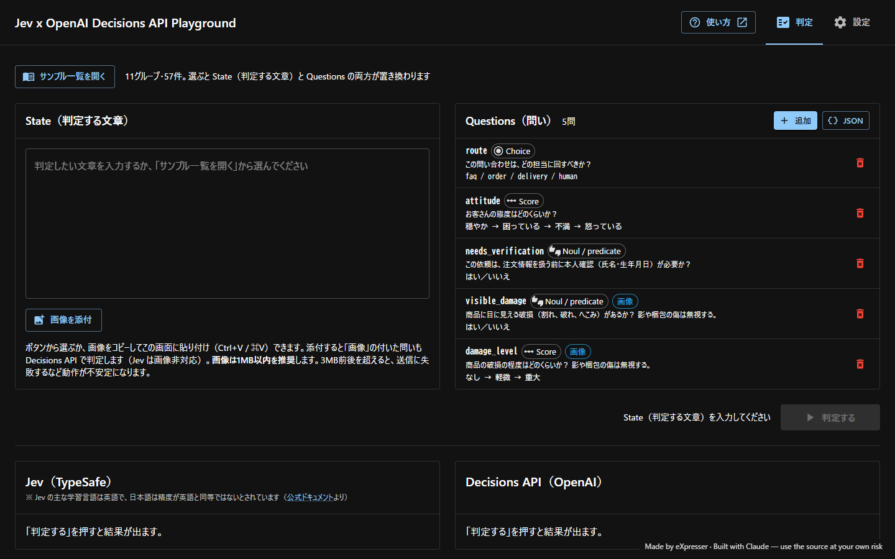
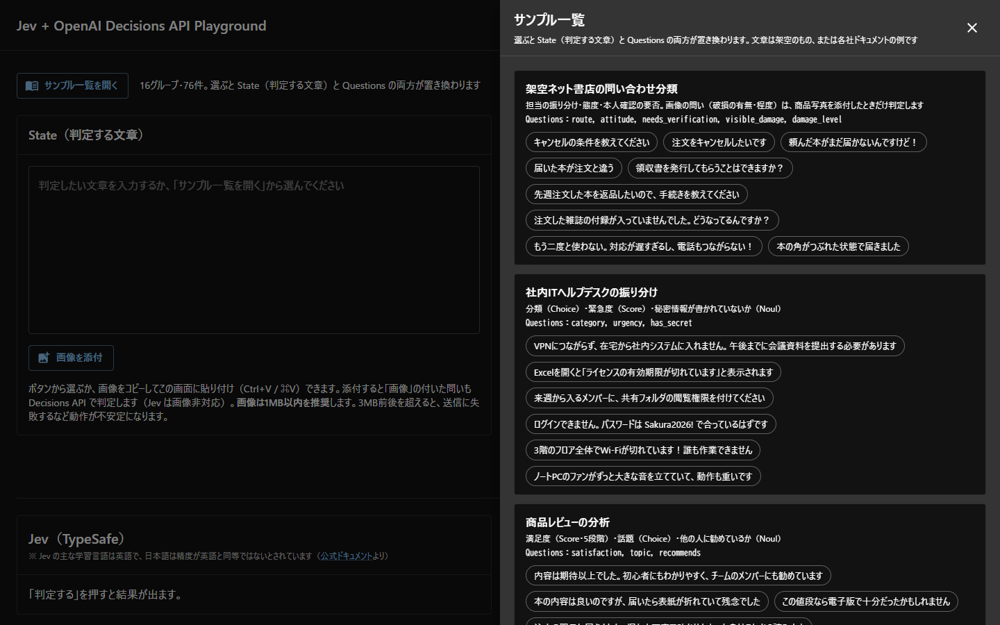
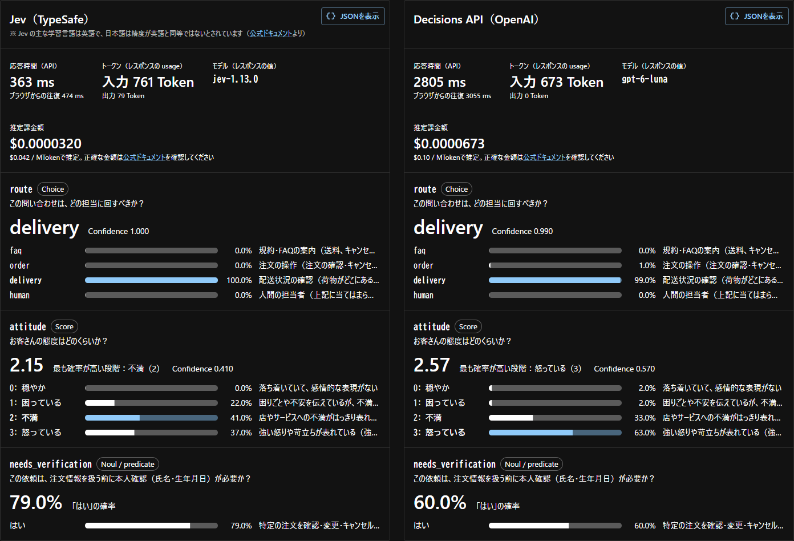
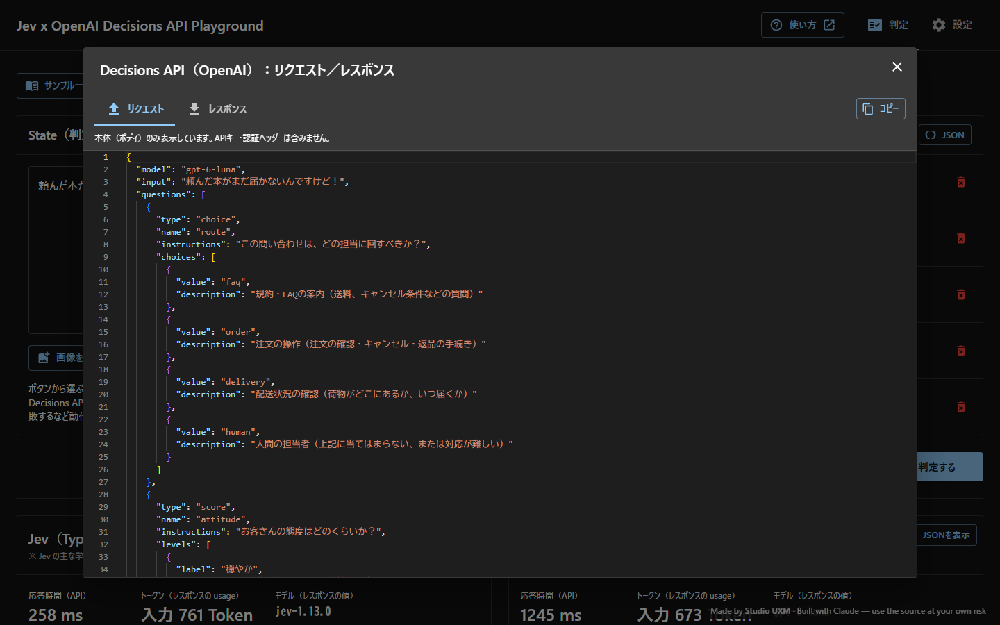
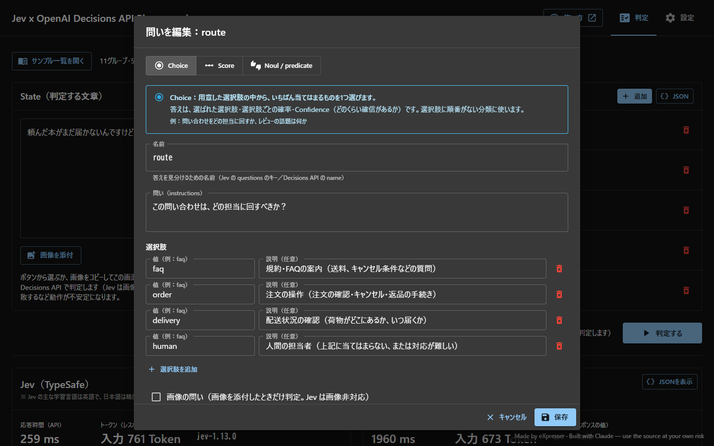
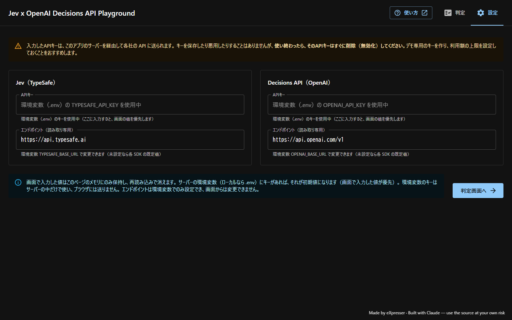

# プレイグラウンドの使い方

[README に戻る](../README.md)

公開中のサイト：https://decisions-api-playground.vercel.app/

> [!WARNING]
> 入力した文章・画像・APIキーは、このアプリのサーバーを経由して各社の API に送られます。
> 個人情報や社内の実データは入力しないでください。APIキーを入力した場合は、使い終わったらすぐに削除（無効化）してください。
> 詳しくは README の[免責事項](../README.md#免責事項必ずお読みください)を読んでください。

## 1. 画面の構成

| 場所 | 内容 |
| --- | --- |
| 右上の「使い方」 | このページを新しいタブで開きます |
| 右上の「判定」「設定」 | 判定画面と設定画面（APIキー）を切り替えます |
| サンプル一覧を開く | 用意したサンプルを選べます。選ぶと State と Questions の両方が置き換わります |
| State（判定する文章） | 判定したい文章を入れます。画像を添付することもできます |
| Questions（問い） | 文章について聞く問いの一覧です。追加・編集・削除できます |
| 判定する | Jev と Decisions API に同じ State と Questions を同時に送ります |
| 下の2つの枠 | 左が Jev（TypeSafe）、右が Decisions API（OpenAI）の結果です |

用語は Jev のドキュメントに合わせています。**State** は判定する対象（文章）、**Questions** はそれについての問いです。

## 2. サンプルを選ぶ

「サンプル一覧を開く」を押すと、右からサンプルの一覧が開きます。

- 同じ Questions を使うサンプルが、グループごとにまとまっています。
- サンプルを押すと一覧が閉じ、State と Questions がそのサンプルの内容に置き換わります。
- マウスを乗せると、期待される結果のメモが表示されます。

用意しているグループ：

| グループ | 何を見られるか |
| --- | --- |
| 架空ネット書店の問い合わせ分類 | 担当の振り分け・お客さんの態度・本人確認の要否（画像を添付すると破損の有無・程度も） |
| 社内ITヘルプデスクの振り分け | 分類・緊急度・パスワードなどの秘密情報が書かれていないか |
| 商品レビューの分析 | 満足度（5段階）・話題・他の人に勧めているか |
| メールの返信要否・優先度 | 返信が必要か・優先度・メールの種類 |
| 英語の問い合わせ分類 | 書店の問いの英語版（日本語との違いを比べる） |
| 【TypeSafe】カスタマーサポートの振り分け | TypeSafe のドキュメントの Intent routing の例 |
| 【TypeSafe】LLM の入力ガードレール | TypeSafe の Cookbook の Guardrails の例 |
| 【TypeSafe】スマートホームのコマンド解釈 | TypeSafe の Smart home デモの例 |
| 【OpenAI】Decisions API ガイドの例 | OpenAI のガイドにある例（部署の振り分け・深刻度・商品写真の破損） |
| 【G-Eval】回答の品質評価 | 質問・AI回答・想定回答から、G-Eval の4観点（一貫性・事実の整合性・流暢さ・関連性）で回答を評価 |
| 【G-Eval】回答の品質評価・英語版 | 上の G-Eval をすべて英語にしたもの |

【TypeSafe】【OpenAI】【G-Eval】のグループには、元にしたドキュメントへのリンク（出典）が表示されます。
文章は、架空のものか、各社のドキュメントの例を訳したものです。

## 3. 判定して結果を見る

State に文章を入れ（またはサンプルを選び）、「判定する」を押します。両方の API が同時に呼ばれ、結果が左右に並びます。

**上の段（応答時間など）**

| 項目 | 意味 |
| --- | --- |
| 応答時間（API） | サーバーから各社の API を呼んで、答えが返るまでの時間。その下は、ブラウザから見た往復の時間 |
| トークン | レスポンスに含まれる入力・出力のトークン数 |
| モデル | レスポンスに含まれる、実際に答えたモデルの名前 |
| 推定課金額 | 入力トークン数に公式の単価を掛けた**推定値**です。正確な金額は各社の管理画面で確認してください |

**各問いの結果**（左右で同じ問いが横に並びます）

| 種類 | 大きく表示される値 | バー |
| --- | --- | --- |
| Choice | いちばん確率が高い選択肢と Confidence（確信の度合い） | 選択肢ごとの確率と、その選択肢の説明 |
| Score | 段階の番号（0から）を確率で重み付けした平均値。段階と段階の間の値にもなります | 段階ごとの確率と、その段階の説明 |
| Noul / predicate | 「はい」である確率 | 「はい」の確率と、「はい」とする条件 |

## 4. 送ったリクエストと、返ってきたレスポンスを見る

結果の枠の右上の「JSONを表示」を押すと、その API に送った JSON と、返ってきた JSON を確認できます。

- 「リクエスト」「レスポンス」のタブで切り替えます。
- 「コピー」で全文をコピーできます。各社の Playground や curl に貼り付ければ、同じ呼び出しを再現できます。
- 表示するのは本体（ボディ）だけです。APIキーや認証ヘッダーは含まれません。
- エラーのときは、ステータスコードとエラーの本体が表示されます。

## 5. 問いを追加・編集する

Questions の一覧の行を押すと編集画面が開きます。「追加」で新しい問いを作れます。

- **種類**：Choice（選択肢から1つ選ぶ）・Score（段階で評価する）・Noul / predicate（はい／いいえの確率）。種類を選ぶと、何をする種類なのかの説明が表示されます。
- **名前**：答えを見分けるための名前です。英字で始め、英数字と `_` だけで付けます。
- **問い**：何を判定するかを書きます。
- **選択肢・段階**：Choice は選択肢を、Score は段階を「低い → 高い」の順に並べます。説明は任意です。
- **画像の問い**：チェックを付けた問いは、画像を添付したときだけ判定します（Jev は画像に対応していないため、Jev 側は「画像非対応」と表示されます）。
- Questions の右上の「JSON」から、問い全体を JSON で直接編集することもできます。
- 変更はブラウザのメモリにだけ保持され、再読み込みすると元に戻ります。

## 6. 画像を添付する

State の下の「画像を添付」から選ぶか、画像をコピーして画面に貼り付け（Ctrl+V / ⌘V）ます。

- 画像を添付すると、「画像」の印が付いた問いも判定します。画像を見られるのは Decisions API だけです。
- **画像は1MB以内を推奨します。** 3MB前後を超えると、送信に失敗するなど動作が不安定になります。
- サンプル画像は用意していません。**自分で撮影した写真**を使ってください。人の顔・住所・伝票の番号などが写った写真や、利用条件がわからない画像は使わないでください。

## 7. 設定画面（APIキー）

「設定」タブで、各社の APIキーを入力できます。

- サーバーにキーが設定されている場合（ハンズオンのときなど）は「環境変数（.env）の … を使用中」と表示され、入力しなくても判定できます。
- 自分のキーを入力すると、そちらが優先されます。入力したキーはブラウザのメモリにだけ保持され、再読み込みで消えます。
- キーの取得先：[OpenAI](https://platform.openai.com/api-keys)、[TypeSafe](https://console.typesafe.ai/keys)（どちらも利用料金がかかります）
- エンドポイント（各社の API の宛先）は表示だけで、画面からは変更できません。

## 8. 知っておきたいこと

- **Jev の言語**：Jev の主な学習言語は英語で、日本語の精度は英語と同等ではないとされています（[公式ドキュメント](https://docs.typesafe.ai/models#language-support)）。英語のサンプルと日本語のサンプルで比べてみてください。
- **G-Eval のスコア**：G-Eval のスコア（確率×点数の合計）は、このアプリの Score の表示値＋1 です（このアプリの段階の番号は0から始まるため）。
- **各 API の提供状況**（2026-10-12 時点）：OpenAI Decisions API は公開ベータで、使えるモデルは `gpt-6-luna` のみです。Jev は固定バージョン `jev-1.13.0` を使っています。どちらも仕様変更により、予告なく動かなくなる可能性があります。
